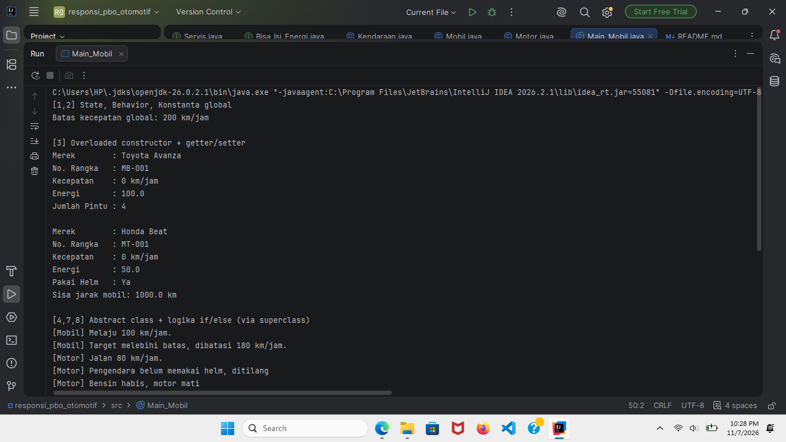
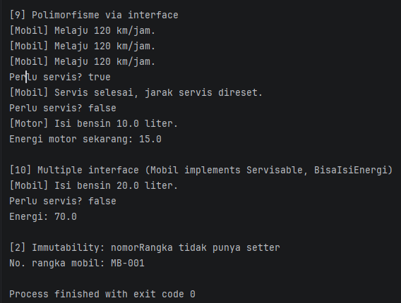

# Responsi Praktikum PBO - Otomotif

- Nama : Fatma Khoeruzdzikrina
- NIM  : H1D025038
- Tema : Otomotif

## Deskripsi
Simulasi sistem kendaraan (Mobil dan Motor) dengan Java yang memenuhi 10 persyaratan teknis responsi

| No | Konsep | Lokasi                                                                                   |
|----|--------|------------------------------------------------------------------------------------------|
| 1 | State & Behavior | `Kendaraan` (atribut, `tampilkanInfo()` void, `hitungSisaJarak()` return)                |
| 2 | Immutability | `batas_kecepatan_global` (public static final), `nomorRangka` (private final)            |
| 3 | Enkapsulasi & Overloading | semua atribut private + getter/setter, `this`, 2 konstruktor di tiap class               |
| 4 | Inheritance | `Mobil` dan `Motor` extends `Kendaraan`; `Main` terpisah                                 |
| 5 | Super chaining | `super(...)` di konstruktor, `super.tampilkanInfo()`                                     |
| 6 | Overriding | `@Override` pada `jalankan()`, `tampilkanInfo()`                                         |
| 7 | Abstract class | `Kendaraan` abstract, `jalankan()` abstract                                              |
| 8 | Logika state | `jalankan()` di `Mobil`/`Motor` memakai if/else yang membaca & mengubah energi/kecepatan |
| 9 | Polimorfisme interface | `Servis s = new Mobil(...)`, `Bisa_Isi_Energi b = new Motor(...)`                        |
| 10 | Multiple interface | `Mobil implements Servis, Bisa_Isi_Energi`                                               |

## Compile dan Run
```bash
javac *.java
java Main_Mobil
```

## Screenshot Luaran


